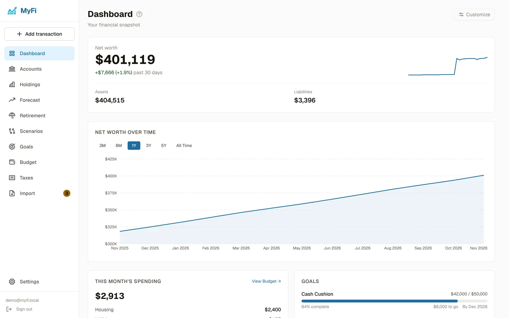
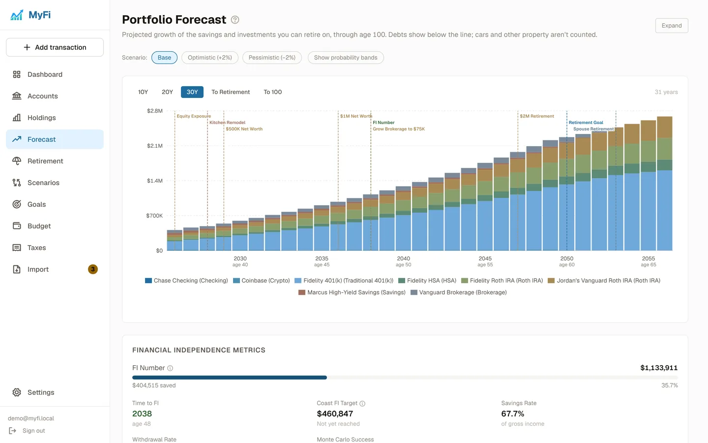
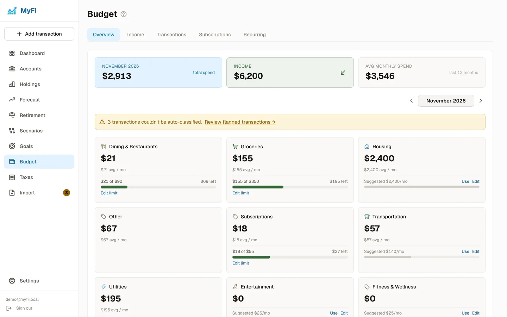

# MyFi

**An open-source, self-hosted personal finance and retirement dashboard.**

MyFi brings every account you have into one place, tracks your investments, budgets your spending, and projects your wealth through retirement. It runs on your own hardware with Docker. Your data stays in your own database, MyFi sends no email, and nothing needs a third-party account to work.

- **One account per instance.** Add a partner under Household to plan as a couple.
- **Works out of the box.** Bank sync (Plaid) and a hosted AI model (Anthropic) are optional extras.
- **No telemetry, no trackers.**



| Forecast | Budget |
|---|---|
|  |  |

<sub>Screenshots use the bundled demo data.</sub>

---

## Quick start

### Requirements

- [Docker](https://docs.docker.com/get-docker/) with Docker Compose
- About 4 CPU cores and 8 GB of RAM. Most of that is for the local model that suggests transaction categories (see [Hardware](#hardware) to run on less).

### 1. Get the code

```bash
git clone https://github.com/cybirdsecurity/myfi-os.git
cd myfi-os
```

### 2. Create your `.env`

```bash
cp .env.example .env
```

Set the two required secrets in `.env`. Generate each one with:

```bash
openssl rand -hex 32
```

| Variable | What it's for |
|---|---|
| `POSTGRES_PASSWORD` | Password for the bundled PostgreSQL database |
| `JWT_SECRET` | Signs your sign-in sessions (at least 32 characters) |

Everything else in `.env` is optional. Docker Compose refuses to start until both are set.

### 3. Start MyFi

```bash
docker compose up -d --build
```

The first build takes a few minutes. On first start the Ollama container also downloads its model in the background, and category suggestions begin once it's ready.

### 4. Create your account

Open **http://localhost:8080**. A fresh instance asks you to create its account, then walks you through a short welcome: about you, your accounts, and your plan. After that, registration is closed.

---

## Configuration

All settings live in `.env`.

| Variable | Default | Description |
|---|---|---|
| `POSTGRES_PASSWORD` | — | **Required.** Database password. |
| `JWT_SECRET` | — | **Required.** Session signing secret, 32+ characters. |
| `SECURE_COOKIES` | `false` | Set to `true` when MyFi is served over HTTPS. |
| `LLM_PROVIDER` | `ollama` | Model for category suggestions: `ollama` (local) or `anthropic`. |
| `OLLAMA_MODEL` | `qwen3:0.6b` | Ollama model to use. A larger model gives better suggestions but needs more RAM. |
| `ANTHROPIC_API_KEY` | — | Required when `LLM_PROVIDER=anthropic`. |
| `ANTHROPIC_MODEL` | Claude Haiku | Anthropic model to use. |
| `PLAID_CLIENT_ID` | — | Plaid client ID. Set it with the next two to turn on bank sync. |
| `PLAID_SECRET` | — | Plaid **production** secret. |
| `MYFI_ENCRYPTION_KEY` | — | Encrypts Plaid access tokens at rest. Generate with `openssl rand -hex 32`. |

`DATABASE_URL`, `PORT` and `ENV` are only used when running the Go server outside Docker (see [Development](#development)).

### Transaction categorization

Imported transactions are categorized by built-in vendor rules and your own history first. For the rest, a background job asks a language model for a suggestion, and you confirm it in the review queue.

- **`ollama` (default):** runs locally in the `ollama` container. No data leaves your server.
- **`anthropic`:** set `LLM_PROVIDER=anthropic` and `ANTHROPIC_API_KEY`. Merchant names are sent to Anthropic's API. Use this on hardware too small for a local model.

The same model is the fallback for recognizing unfamiliar CSV formats and for reading cost-basis files. If no model is reachable, categorization still works from rules and your history; everything else lands in the review queue.

### Bank sync with Plaid (optional)

MyFi is fully usable without Plaid: enter accounts by hand and import statements. If you want balances, holdings and transactions to update on their own:

1. Create a Plaid account and get your client ID and **production** secret at https://dashboard.plaid.com/developers/keys (Plaid's free trial uses production keys).
2. Set `PLAID_CLIENT_ID`, `PLAID_SECRET` and `MYFI_ENCRYPTION_KEY` in `.env`, then run `docker compose up -d`. MyFi refuses to start if only some of the three are set.
3. Use **Accounts → Connect Institution**.

What syncs:

- **Investment accounts:** holdings, cost basis and balances. Retirement accounts also record this year's contributions. A new link can backfill up to 24 months of weekly history.
- **Bank and credit accounts:** balances and transactions (into Budget), plus credit-card and mortgage details.

How syncing works:

- **Daily sync:** a background job refreshes every connection using Plaid's cached balances, which aren't billed per call.
- **Sync now / Sync all:** these fetch live balances, which Plaid bills per call.
- **Mapping:** linked accounts attach to your existing MyFi accounts or new ones. Manual history is never overwritten.
- **Managing connections:** Settings → Plaid Connections lists and removes connections. Unlinking keeps the account and its data.

Connections, limits and fees are on your own Plaid account. Banks that sign in through OAuth aren't supported yet. Access tokens only work with the client ID that created them, so changing `PLAID_CLIENT_ID` means reconnecting each bank.

### Hardware

The `ollama` container is capped at 4 CPUs and 6 GB of RAM in `docker-compose.yml`. On a smaller machine you have two options:

- Lower `cpus` and `mem_limit` under `ollama` (Docker won't start a container that asks for more CPUs than the host has), and keep the small default model.
- Use `LLM_PROVIDER=anthropic`. The `ollama` container still starts, but you can stop it.

---

## Running MyFi

### Access from other devices

PostgreSQL and MyFi listen on `127.0.0.1` only. To use MyFi from your phone or another computer, put a reverse proxy with HTTPS in front of port `8080` (for example Caddy, nginx, or a tunnel) and set `SECURE_COOKIES=true`. Over HTTPS, MyFi can be installed to your phone's home screen as an app.

### Backups

All your data is in the PostgreSQL database (the `pgdata` volume). The `ollama_data` volume only caches the model and doesn't need backing up.

```bash
make backup                                                # writes backups/myfi_<timestamp>.sql.gz
make restore FILE=backups/myfi_20260101_120000.sql.gz      # replaces all current data; asks first
```

A restore stops MyFi while it runs and is all-or-nothing: if the backup can't be loaded, your current data is left as it was.

Run `make backup` from cron or a systemd timer, and prune old files (for example `find backups -mtime +30 -delete`).

If you use Plaid, also keep a copy of `MYFI_ENCRYPTION_KEY`. Restoring a backup under a different key breaks every bank connection until you remove and re-link them.

### Upgrading

```bash
git pull
docker compose up -d --build
```

Database migrations run automatically when MyFi starts. Back up first.

### Resetting your password

MyFi doesn't send email, so a forgotten password is reset on the server:

```bash
make reset-password
# or
docker compose exec -it app /bin/myfi reset-password
```

It asks for the new password twice, clears any login lockout, and signs out every session. For scripts, pipe the password in with `--password-stdin`.

### Security notes

- Ten wrong sign-in attempts lock the account for 15 minutes.
- Changing your password (**Settings → Password**) signs out every other session.
- Keep `.env` private. It holds your database password, session secret and any API keys.

---

## Features

### Dashboard
- **Overview:** net worth, how it has changed, allocation by asset class and tax treatment, and goal progress.
- **Debt and notices:** debt payoff progress, a nudge when imported transactions need review, and a notice when retirement contributions are off plan.
- **Optional cards:** cash flow and savings rate, portfolio check-up, and top movers.
- **Customize:** drag, resize, hide and add cards; the layout is saved per browser.
- **Net worth chart:** a simple line, or stacked bars per account.

### Accounts
- **Account types:** checking, savings, brokerage, 401(k), 403(b), 457(b), IRA, Roth IRA, HSA, crypto, home, vehicle, loans and credit cards.
- **Ownership:** each account can be yours, your partner's, or joint.
- **Home accounts:** mortgage details, an amortization schedule, and ownership costs (property tax, insurance, HOA, PMI). You enter the home's value yourself.
- **Vehicle accounts:** year, make, model and your own estimated value.
- **Credit cards and loans:** APR, payments and limits, used to pay debts down in the forecast.
- **Balance history:** add balances by hand at any time, and investment accounts are snapshotted automatically each week.

### Holdings
- **Prices:** live prices from Yahoo Finance, with manual price overrides.
- **Gains:** cost basis and unrealized gains.
- **Combined view:** one combined view across accounts, and ticker detail pages.
- **Dividends:** dividend history.
- **Risk:** concentration analysis, fund look-through, and drift from your allocation targets.

### Forecast and retirement
- **Projection:** to age 100 with base, optimistic and pessimistic scenarios, Monte Carlo probability bands, and a historical backtest.
- **Inputs:** balances, contributions, return rates by asset class, inflation, Social Security, debt payments, planned purchases and your partner's details.
- **FI metrics:** FI number, time to FI, Coast FI, withdrawal rate and a retirement readiness score.
- **Retirement:** how long the money lasts at a spending level you choose, plus 4/5/6% withdrawal scenarios.
- **Withdrawals:** taxable first, then tax-deferred, then tax-free, with required minimum distributions.

### Scenarios
- **What-If:** compares up to three alternatives with your current plan.
- **Solve For:** finds the value of one variable that reaches a target.

### Goals
- **What a goal can track:** net worth, one account, an account type, or an asset class.
- **Planned purchases:** the forecast deducts them in their year.
- **Projections:** each goal shows the year it's projected to be reached.

### Contributions
- **Amounts:** a recurring dollar amount, or a percentage of income that grows with your salary.
- **Employer match:** tiered matches.
- **This year so far:** compares actual contributions with the plan for retirement accounts, and offers a one-click plan update when you're off pace.

### Budget
- **Transactions:** add them by hand (the quick-add button works from any page), import a CSV, or sync from Plaid.
- **Categories:** vendor rules learn from your corrections, and uncertain transactions go to a review queue.
- **Views:** monthly spending by category, income, and recurring transactions.
- **Monthly limits:** per category, with suggested amounts based on your recent spending.
- **Subscriptions:** detected automatically from repeating charges.

### Taxes
- **Brackets:** where your income falls in the tax brackets.
- **Planning:** Roth conversion planning and withdrawal order.
- **ACA:** health-insurance subsidy limits for early retirees.

### Household
- **Partner:** optional, under the same login, with their own birthday, income, retirement age and Social Security.
- **Combined plan:** the forecast and tax calculations include both of you.

### Import and export
- **Balance history:** CSV.
- **Holdings:** OFX/QFX files, with an institution match and a preview before anything is written.
- **Cost basis:** CSV.
- **Bank transactions:** CSV, into Budget.
- **Full backup:** a JSON export you can import into another MyFi instance.

### Everywhere
- **Mobile layout:** a bottom tab bar on phones, and installable as an app over HTTPS.
- **Theme:** light and dark.
- **Help:** a short guide on each page (reopen it with **?**) and plain-language tooltips for financial terms.

---

## Development

### Prerequisites

- Docker with Docker Compose
- [Go 1.26](https://go.dev/dl/) (latest patch release)
- [Node.js 22.12+](https://nodejs.org/)

### Run locally

```bash
cp .env.example .env              # set POSTGRES_PASSWORD and JWT_SECRET
docker compose up -d db ollama    # database and local model
make install                      # frontend dependencies
make dev-api                      # Go API on :8080 (reads .env, uses DATABASE_URL)
make dev-web                      # Vite dev server on :5173, in a second terminal
```

### Commands

```bash
make test                # Go tests
npm --prefix web test    # frontend tests
make build               # build the frontend and the Go binary
make migrate-down        # roll back one migration
make seed                # load demo data into a fresh instance (see below)
make reseed-demo         # drop and reload the demo data
```

When running the server with `go run`, reset the password with `go run ./cmd/server reset-password`.

### Demo data

`make seed` loads a complete demo household into an instance that has **no account yet**. Since an instance holds one account, use it on a development database, never on your real one. Sign in as `demo@myfi.local` / `demo1234`.

The demo covers every feature:
- **Accounts and history:** 9 accounts across you, a partner and joint ownership, 15 months of history, holdings and dividends.
- **Planning:** goals of every type, and contribution plans with employer matches.
- **Budget:** a year of transactions with limits, recurring bills, subscriptions and a review queue.
- **Linked-account examples:** Plaid-linked accounts that show the sync indicators without a real connection.

### Project structure

```
myfi-os/
├── cmd/server/        # Server entry point and the reset-password command
├── internal/
│   ├── api/           # HTTP handlers and routing
│   ├── auth/          # Sessions and password hashing
│   ├── crypto/        # Encryption for Plaid tokens
│   ├── data/          # Embedded historical returns and fund data
│   ├── db/            # Database queries
│   ├── models/        # Data models
│   ├── prices/        # Yahoo Finance prices
│   └── services/      # Forecast, net worth, imports, categorization, Plaid
├── docs/screenshots/  # README screenshots
├── migrations/        # PostgreSQL schema migrations
├── scripts/           # Demo seed, backup and restore
├── web/               # React + TypeScript frontend (Vite, Tailwind)
├── Dockerfile         # Multi-stage build: frontend, Go binary, minimal runtime image
└── docker-compose.yml # PostgreSQL, Ollama and MyFi
```

**Stack:** Go (chi, sqlx, golang-migrate) with PostgreSQL; React 18, TypeScript, Vite, Tailwind CSS, Recharts and SWR.

---

## Contributing and security

Contributions are welcome. See [CONTRIBUTING.md](CONTRIBUTING.md). To report a security issue privately, see [SECURITY.md](SECURITY.md).

---

## License

MyFi is released under the [MIT License](LICENSE). It bundles the Geist font under the [SIL Open Font License](web/public/fonts/geist-sans/OFL.txt).
